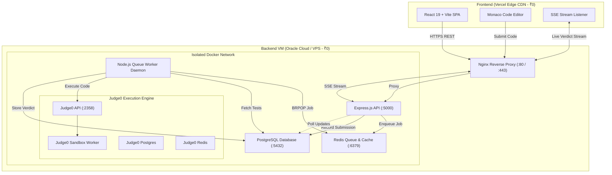

# 🧠 AetherJudge

[](https://vercel.com/new/clone?repository-url=https%3A%2F%2Fgithub.com%2FIndiralaVarshith%2FAetherJudge&root-directory=frontend)
[](https://opensource.org/licenses/ISC)
[](https://nodejs.org/)
[](https://www.docker.com/)

A modern, scalable online code execution and judging platform featuring an interactive Monaco Editor, real-time Server-Sent Events (SSE) verdict streaming, an asynchronous Redis queue with worker daemons, and sandboxed arbitrary code execution powered by Judge0.

---

## 🏗️ Architecture Overview



---

## ✨ Features

- **Problem library:** 1,000+ problems imported from open datasets, with no duplicates (see [Importing Problems](#-importing-problems)).
- **Albums:** 12 topic collections (Basics, Math, Strings, Arrays, Sorting & Searching, Greedy, Data Structures, Bit Manipulation, Dynamic Programming, Graphs, Trees, Game Theory), listed in learning order, easy → hard inside each.
- **Guide me:** a 132-step path through all 12 albums, with progress and a "continue" button.
- **Workspace:** Monaco editor, resizable panes, statements rendered with Markdown and LaTeX maths, run with custom input, submit with live test-by-test verdicts.
  - Code autosaves per problem and language; private notes and bookmarks per problem.
  - Timer, Zen mode (`Alt Z`), font size, reset to starter code, previous / next / random problem.
  - Shortcuts: `⌥ ↵` run, `⌘ ↵` (Ctrl ↵) submit, `⌘ K` (Ctrl K) search anything.
- **Motivation:** XP (easy +10, medium +25, hard +50), levels, daily streaks, confetti on accepted solutions, a daily problem, a leaderboard and a profile page with an activity heatmap.
- **Accounts:** sign up / sign in with secure sessions; progress is saved per user (see [Accounts & Sessions](#-accounts--sessions)). Guests can practise, but nothing is saved for them.
- **Dark and light themes**, works on phones.

---

## 💻 Technology Stack

| Layer | Technology | Purpose |
| :--- | :--- | :--- |
| **Frontend** | React 19, Vite, Monaco Editor | App and code editor |
| **UI libraries** | Motion, cmdk, Sonner, canvas-confetti, react-markdown + KaTeX, react-resizable-panels, Lucide icons | Animation, ⌘K palette, toasts, celebrations, statement rendering, resizable panes, icons |
| **Hosting (Frontend)**| Vercel (Hobby Free Tier) | Global CDN, free SSL |
| **Backend API** | Node.js, Express.js 5 | REST API, authentication, live verdicts (SSE) |
| **Message Broker** | Redis 7 | Submission queue (`code_submission_queue`) |
| **Worker** | Node.js | Runs each submission against every test case |
| **Code Execution** | Judge0 Community Edition 1.13.1 (Docker) | Sandboxed compile and run |
| **Database** | PostgreSQL 16 | Users, problems, test cases, submissions |
| **Reverse Proxy** | Nginx | Production only: SSL, proxy, SSE buffering |

---

## 🧑‍💻 Languages & Compiler Versions

Code runs inside **Judge0**, which compiles and executes it in an isolated sandbox. The versions are fixed by the Judge0 image:

| Language in the editor | Compiler / runtime | Judge0 language id | Extra flags |
| :--- | :--- | :--- | :--- |
| Python 3.8 | Python 3.8.1 | 71 | – |
| C (C17) | GCC 9.2.0 | 50 | `-std=c17 -O2` |
| C++17 | GCC 9.2.0 | 54 | `-std=c++17 -O2` |
| Java 13 | OpenJDK 13.0.1 | 62 | – |

- The mapping lives in [backend/src/languages.js](backend/src/languages.js). `GET /api/languages` returns it, and `GET http://localhost:2358/languages` lists everything Judge0 can run.
- Programs read from **standard input** and print to **standard output**. Starter code is beginner-friendly (`input()` in Python, `scanf` in C, `cin` in C++, `Scanner` in Java).
- Java code must use `public class Main`.

**Why Judge0, and is there something newer?** Judge0 CE is free, open source, sandboxed and handles test cases and limits for us. Its last release (1.13.1, April 2024) still ships 2019–2020 compilers. The main free alternative, [Piston](https://github.com/engineer-man/piston), offers Python 3.12, GCC 10.2 and Java 15. That is only modestly newer and it would mean rewriting the worker, so we stay on Judge0 for now.

---

## 🚀 Quickstart: Local Development

### Prerequisites
- **Node.js 18+** (developed on Node 24)
- **Docker Desktop**, running
- About 3 GB of free disk for the Docker images

> [!NOTE]
> On Apple Silicon Macs, Judge0 runs through emulation (its image is x86-only). Docker prints a "platform (linux/amd64) does not match" warning, which is expected. Judging is slower than on a real x86 server.

### 1. Clone the repository
```bash
git clone https://github.com/IndiralaVarshith/AetherJudge.git
cd AetherJudge
```

### 2. Start PostgreSQL and Redis (Docker)
First time only, create the two containers (they restart with Docker afterwards):
```bash
docker run -d --name aether-postgres --restart unless-stopped -p 127.0.0.1:5433:5432 \
  -e POSTGRES_USER=admin -e POSTGRES_PASSWORD=admin123 -e POSTGRES_DB=aetherjudge \
  -v aether_pgdata_dev:/var/lib/postgresql/data postgres:16-alpine
docker run -d --name aether-redis --restart unless-stopped -p 127.0.0.1:6380:6379 redis:7-alpine
```
Later, if they are stopped:
```bash
docker start aether-postgres aether-redis
```
The values above match `backend/.env.example`. If you change them, change both.

### 3. Start Judge0
```bash
cd judge0
docker compose up -d
cd ..
curl http://localhost:2358/about   # should print Judge0's version after ~30 s
```

### 4. Start the backend API and worker
```bash
cd backend
cp .env.example .env     # first time only; then set JWT_SECRET and ADMIN_SECRET
npm install
npm run dev              # API on http://localhost:5000 (creates/updates the database tables)
```
In a **second terminal**:
```bash
cd backend
npm run worker           # judges queued submissions
```

### 5. Load problems (first time only)
In a third terminal, from `backend/`:
```bash
npm run import:exercism
npm run import:taco -- --easy 200 --medium 200 --hard 100
```
See [Importing Problems](#-importing-problems) for details. Without this step the site only has the 8 starter problems.

### 6. Start the frontend
```bash
cd frontend
echo "VITE_API_BASE=http://localhost:5000/api" > .env.development   # first time only
npm install
npm run dev              # http://localhost:5173
```
Open **http://localhost:5173**.

> [!IMPORTANT]
> Every `npm` command must be run inside `backend/` or `frontend/`. Running it from the project root fails with "Could not read package.json".

### Useful backend scripts

| Command (in `backend/`) | What it does |
| :--- | :--- |
| `npm run dev` | Start the API |
| `npm run worker` | Start the submission worker |
| `npm run import:taco -- --easy N --medium N --hard N` | Add problems from the TACO dataset |
| `npm run import:exercism` | Add problems from Exercism |
| `npm run fix:titles` | Replace code-style titles ("Codeforces 1539C") with real names. Add `-- --deep` to also query individual Codeforces contests (a few MB each) |
| `npm run albums` | Re-sort every problem into albums after editing `src/albums.js` |
| `node importers/fix-unsafe-numbers.js` | One-off repair for Exercism tests imported before huge numbers were skipped |

---

## 📚 Importing Problems

Problems come from open datasets and are imported with scripts in `backend/importers/`. Both importers are safe to re-run: anything already in the database is skipped.

```bash
cd backend
npm run import:taco -- --easy 200 --medium 200 --hard 100   # TACO dataset (Apache-2.0), ~25,000 problems available
npm run import:exercism                                     # Exercism problem-specifications (MIT)
```

Add `--dry-run` to either command to see what would be added without saving anything.

- **TACO** downloads its data from Hugging Face in blocks of 1,000 problems (40–130 MB each) and stops once the requested numbers are reached. Each run adds that many *new* problems.
- **Titles:** many TACO problems have no name, so they start as codes like "Codeforces 1539C". After each import the importer looks up the real names from the official Codeforces API and the AtCoder Problems dataset. Kattis and CodeChef problems keep their codes for now.
- **Albums:** new problems are sorted into albums automatically, from their tags or, when they have none, from words in their title and statement.
- **Exercism** only imports exercises that convert cleanly to input/output problems (about 48 of 135), and skips tests with numbers too large for JavaScript.

**No duplicates.** Every problem, whatever its source (including ones created through `POST /api/problems`), passes four checks before it is published:

| Check | Catches | Result |
| :--- | :--- | :--- |
| Same source + source id | Re-running an import | Skipped |
| Same statement fingerprint | Copies with different formatting or constants | Skipped |
| Same test cases | The same problem in different words | Skipped, or held for review when only most tests match |
| Similar wording (`pg_trgm`) or same title | Near copies and paraphrases | Skipped when near-identical, otherwise held for review |

Problems held for review are stored with `status = 'review'` and `duplicate_of = <id>` and stay hidden from users. To list them:

```sql
SELECT id, title, source, duplicate_of, similarity FROM problems WHERE status = 'review';
-- approve one:  UPDATE problems SET status = 'published' WHERE id = <id>;
```

Only sample test cases are sent to the browser. Hidden test cases are read by the worker directly from the database.

---

## 🔐 Accounts & Sessions

- **Sign up** needs a username (3–20 letters, numbers or `_`, unique ignoring case), an email (unique, stored lowercase) and a password of 8–72 characters. Passwords are stored as bcrypt hashes (cost 12), never in plain text.
- **Sessions** are a signed token (JWT, 7 days) in an **HTTP-only cookie**, so page scripts can't read it. On load the site calls `GET /api/auth/me` to check it; an expired or missing cookie means signed out.
- **Your data is yours:** submissions, history, stats and the live verdict stream are tied to the session on the server. A user id sent by the browser is ignored, and nobody can read another user's submissions.
- **Continue with Google** (optional): one-click sign-in once you set `GOOGLE_CLIENT_ID` (see below). The server verifies every Google token with Google's official library and only accepts emails Google has verified.
  - The first Google sign-in creates an account (username from the person's name), with no password.
  - If someone already signed up with a password using the same email, Google is linked to that account instead of creating a second one. Both ways of signing in then work.
- **Guests** can run and submit code, but nothing is saved for them. Accepted solutions prompt them to create an account.
- **Data is kept** until it is deleted. Sessions expire after 7 days (just sign in again); accounts and submissions don't expire.
- **Abuse limits** (per API process): 10 sign-in attempts per 15 minutes per IP and email, 30 Google sign-ins per 15 minutes per IP, 10 sign-ups per hour per IP, 20 runs/submissions per minute per user (or per IP for guests), and 64 KB of code per request.

| Endpoint | What it does |
| :--- | :--- |
| `POST /api/auth/register` | Create an account and sign in |
| `POST /api/auth/login` | Sign in with email and password |
| `POST /api/auth/google` | Sign in or sign up with a Google ID token |
| `GET /api/auth/config` | Public sign-in settings (the Google client ID, or `null`) |
| `GET /api/auth/me` | Who is signed in (`{ "user": null }` for guests) |
| `POST /api/auth/logout` | Sign out |

### Setting up "Continue with Google" (free)

The button stays hidden until the server has a Google client ID. To get one:

1. Open [Google Cloud Console](https://console.cloud.google.com/) with your Google account and create a project (e.g. "AetherJudge").
2. Go to **APIs & Services → OAuth consent screen** (also called **Google Auth Platform → Branding**):
   - user type **External**;
   - app name **AetherJudge**, your support email, your developer contact email;
   - no extra scopes are needed (email and profile are included).
3. Under **Audience**, the app starts in **Testing**: only the Google accounts you add under **Test users** can sign in. Click **Publish app** when you're ready for everyone. Email and profile sign-in does not need Google's review.
4. Go to **Credentials → Create credentials → OAuth client ID**:
   - application type **Web application**;
   - under **Authorized JavaScript origins**, add `http://localhost:5173` and `http://localhost` for local development, plus your real site later (e.g. `https://aetherjudge.vercel.app`);
   - no redirect URIs are needed (the button uses a popup).
5. Copy the **Client ID** (it ends in `.apps.googleusercontent.com`) into `backend/.env`:
   ```bash
   GOOGLE_CLIENT_ID=1234567890-abc123.apps.googleusercontent.com
   ```
6. Restart the API (`npm run dev` in `backend/`). The **Continue with Google** button now appears on the sign-in page.

The client ID is public by design (it appears in the page). There is no client secret to keep: this flow doesn't use one. Origin changes in Google Cloud can take a few minutes to apply.

> [!IMPORTANT]
> **Production needs HTTPS on the API.** When the frontend (e.g. Vercel) and the API are on different domains, browsers only send the session cookie with `SameSite=None; Secure`, which works over HTTPS only. That is the production default. Also set a long random `JWT_SECRET`: the API refuses to issue sessions in production without one.

---

## 📈 How Many Users Can It Handle on Free Resources?

These are estimates for the free deployment below, not load-test results.

**Accounts and saved data:** storage is not the limit. Measured locally: all 1,054 problems with their tests take about 16 MB, and one submission row averages about 270 bytes plus the code itself (usually 0.5–2 KB).
- On a free managed Postgres with about 0.5 GB (Neon, Supabase), that is roughly **200,000–400,000 saved submissions**, enough for thousands of active users.
- Postgres on the free VM's own disk (tens of GB) holds millions.

**People using the site at the same time:** browsing problems, albums and profiles is cheap. A single small server handles a few hundred people at once.

**People submitting at the same time:** Judge0 is the bottleneck. On the free Oracle AMD micro VM (1/8 CPU, 1 GB RAM) one worker judges one submission at a time:
- a Python or C++ test takes roughly 0.1–0.5 s; Java takes longer because the JVM starts for every test;
- a 10-test submission takes about 2–10 s, so the server judges about **6–30 submissions per minute**.

If an active coder submits every 3–5 minutes, that is **about 30–100 people coding at the same moment** before the queue starts to lag. Extra submissions wait in the queue rather than fail, and the per-user rate limit keeps one person from hogging it.

**To grow beyond that:**
- a bigger x86 server, or more Judge0 workers;
- Judge0 runs well on cheap x86 VPSs;
- Oracle's free ARM VMs are larger, but the Judge0 image is x86-only, so it would run under slow emulation there.

---

## 🌐 ₹0 Cloud Deployment Guide

AetherJudge is engineered for a **completely free (₹0)** two-tier deployment:
1. **Frontend**: Vercel Free Hobby Tier.
2. **Backend & Judge0**: Oracle Cloud Infrastructure (OCI) Always Free Compute or any Linux VPS.

---

### Tier 1: Frontend Deployment on Vercel (₹0)

1. Fork or push this repository to your GitHub account (`IndiralaVarshith/AetherJudge`).
2. Go to **[vercel.com](https://vercel.com)** and sign in with GitHub.
3. Click **"Add New Project"** $\rightarrow$ select `AetherJudge`.
4. Configure Project Settings:
   - **Root Directory**: `frontend`
   - **Framework Preset**: `Vite`
   - **Build Command**: `npm run build`
   - **Output Directory**: `dist`
5. Under **Environment Variables**, add:
   - `VITE_API_BASE`: `https://your-backend-domain.com/api` *(or your VM IP: `http://<VM_IP>/api`)*
6. Click **Deploy**. Vercel will build and assign you a free `https://<project-name>.vercel.app` URL with free global SSL.

---

### Tier 2: Backend & Sandbox Deployment (₹0 VM)

#### OCI Always Free Architecture Assessment
> [!IMPORTANT]
> - **Architecture Requirement**: The official Judge0 Community Edition image (`judge0/judge0:latest`) is compiled strictly for **`linux/amd64` (x86_64)**.
> - **Oracle Cloud VM Choice**: When creating your OCI Always Free instance, select the **AMD Compute instance (`VM.Standard.E2.1.Micro`)** running **Ubuntu 22.04 LTS**. Because this VM is native x86_64, Judge0's sandboxing kernel calls execute natively without emulation crashes.
> - **RAM Optimization**: OCI AMD Micro instances offer 1 GB RAM. To prevent Out-Of-Memory (OOM) issues during C++ and Java compilations, our automated `deploy.sh` script configures a **4 GB NVMe swapfile**, allowing the entire stack to run stably within free-tier limits.

#### 1-Click VM Deployment Steps:

1. **Launch an OCI Always Free VM**:
   - Shape: `VM.Standard.E2.1.Micro` (AMD, Always Free).
   - Image: `Ubuntu 22.04 Minimal LTS`.
   - Security List / Ingress Rules: Allow TCP ports `22`, `80`, and `443`.

2. **SSH into your VM**:
   ```bash
   ssh -i /path/to/key ubuntu@<VM_PUBLIC_IP>
   ```

3. **Clone & Run the 1-Click Installer**:
   ```bash
   git clone https://github.com/IndiralaVarshith/AetherJudge.git
   cd AetherJudge
   chmod +x deploy.sh
   ./deploy.sh
   ```

The script automatically:
- Installs Docker & Docker Compose plugin.
- Creates and enables a 4 GB swapfile.
- Opens firewall ports (80, 443).
- Builds and starts the unified production stack ([docker-compose.prod.yml](docker-compose.prod.yml)).
- Runs health checks to confirm all 9 services are operational.

---

## ⚙️ Environment Variables Reference

### Frontend (`frontend/.env.development` locally, hosting settings in production)
| Variable | Description | Example |
| :--- | :--- | :--- |
| `VITE_API_BASE` | URL of the backend `/api` endpoint | Local: `http://localhost:5000/api` · Production: `https://api.yourdomain.com/api` |

### Backend (`backend/.env` / `.env.production`)
| Variable | Description | Example |
| :--- | :--- | :--- |
| `NODE_ENV` | Environment mode | `development` / `production` |
| `PORT` | API listening port | `5000` |
| `CLIENT_ORIGIN` | Allowed frontend origin for CORS | `http://localhost:5173` |
| `DB_HOST` | PostgreSQL hostname | `localhost` (local) · `postgres` (Docker) |
| `DB_PORT` | PostgreSQL port | `5433` (local) · `5432` (Docker) |
| `DB_USER` | Database user | `admin` |
| `DB_PASSWORD` | Database password | `admin123` (local only) |
| `DB_NAME` | Database name | `aetherjudge` |
| `REDIS_URL` | Redis connection URL | `redis://127.0.0.1:6380` |
| `JUDGE0_URL` | Judge0 server URL | `http://localhost:2358` |
| `JWT_SECRET` | Secret key for signing login tokens | any long random string |
| `ADMIN_SECRET` | Required in the `x-admin-secret` header to create problems via `POST /api/problems` | any long random string |
| `COOKIE_SAMESITE` | Optional. Session cookie SameSite policy. Defaults to `lax` locally and `none` in production | `none` |
| `COOKIE_SECURE` | Optional. `true` sends the cookie over HTTPS only. Defaults to `false` locally and `true` in production | `true` |
| `GOOGLE_CLIENT_ID` | Optional. Enables "Continue with Google" (see [setup](#setting-up-continue-with-google-free)) | `1234…apps.googleusercontent.com` |

---

## 🔍 Verification & Troubleshooting

### Check service health
```bash
curl http://localhost:5000/health          # API (local)
curl http://localhost:2358/about           # Judge0
curl http://localhost:5000/api/languages   # languages the judge accepts
docker ps                                  # containers
```

### Common problems

| Symptom | Cause | Fix |
| :--- | :--- | :--- |
| Site says **"Could not reach AetherJudge. Is the API running?"** | API not running, or stuck waiting for the database | Start it with `npm run dev` in `backend/`. If it hangs, see the next row |
| API starts but never prints "Server running" | Postgres/Redis containers show "Up" but lost their port mappings (seen after Docker Desktop restarts) | `docker restart aether-postgres aether-redis`, then restart the API and worker |
| `npm` error **"Could not read package.json"** | Command run from the wrong folder | `cd backend` or `cd frontend` first |
| `docker compose up` in `judge0/`: **"mounts denied … is not shared from the host"** | Terminal path spelled `/users/...` instead of `/Users/...` | Open a new terminal, `cd /Users/<you>/.../AetherJudge/judge0`, run it again |
| Submissions stay on "In the queue…" | Worker not running | `npm run worker` in `backend/` |
| Judging is slow | Judge0 runs under emulation on Apple Silicon | Expected locally; x86 servers are much faster |

### Production (Docker Compose)
```bash
curl http://localhost/health
docker compose -f docker-compose.prod.yml logs -f api
docker compose -f docker-compose.prod.yml logs -f worker
git pull origin main && docker compose -f docker-compose.prod.yml up -d --build
```
