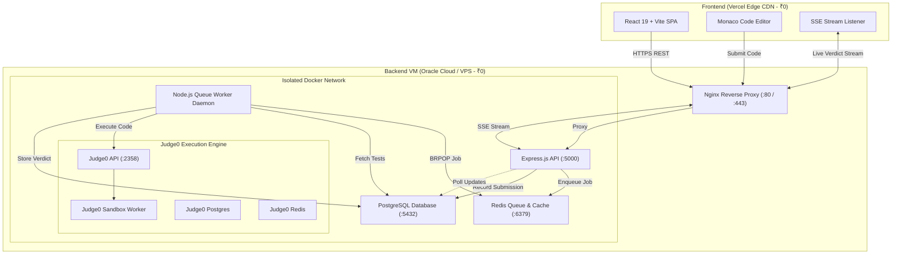

# 🧠 AetherJudge

[](https://vercel.com/new/clone?repository-url=https%3A%2F%2Fgithub.com%2FIndiralaVarshith%2FAetherJudge&root-directory=frontend)
[](https://opensource.org/licenses/ISC)
[](https://nodejs.org/)
[](https://www.docker.com/)

A modern, scalable online code execution and judging platform featuring an interactive Monaco Editor, real-time Server-Sent Events (SSE) verdict streaming, an asynchronous Redis queue with worker daemons, and sandboxed arbitrary code execution powered by Judge0.

---

## 🏗️ Architecture Overview



---

## 💻 Technology Stack

| Layer | Technology | Purpose |
| :--- | :--- | :--- |
| **Frontend** | React 19, Vite, Monaco Editor | High-performance interactive IDE & UI |
| **Hosting (Frontend)**| Vercel (Hobby Free Tier) | Global CDN edge hosting, free SSL, zero maintenance |
| **Backend API** | Node.js, Express.js 5 | RESTful API, authentication & SSE streaming |
| **Message Broker** | Redis 7 (Alpine) | Job queue (`code_submission_queue`) |
| **Worker Layer** | Node.js Daemon | Background test-case evaluation & auto-recovery |
| **Code Execution** | Judge0 Community Edition (Docker) | Isolated, sandboxed compilation & execution (Python, C++, Java) |
| **Primary Database** | PostgreSQL 16 (Alpine) | Persistent users, problems, test cases, verdicts |
| **Reverse Proxy** | Nginx (Alpine) | SSL termination, reverse proxy, SSE buffer handling |

---

## 🔒 Security & Sandboxing Model

1. **Sandboxed Code Execution**: Untrusted user code is **never** executed inside the API process or host OS. Execution occurs exclusively inside isolated Linux namespaces and cgroups managed by Judge0.
2. **Network Isolation**: PostgreSQL, Redis, and Judge0 internal APIs are strictly bound to the internal Docker network (`aether_internal`). Only Nginx (`:80`/`:443`) is exposed publicly.
3. **Defense Against Denial of Service**: CPU time limits (5s default) and memory constraints prevent infinite loops and memory exhaustion.
4. **Credential Safety**: All environment secrets and database passwords are injected at runtime via environment variables and never checked into source control.

---

## 🚀 Quickstart: Local Development

### Prerequisites
- Node.js (v18+)
- Docker & Docker Desktop

### 1. Clone the repository
```bash
git clone https://github.com/IndiralaVarshith/AetherJudge.git
cd AetherJudge
```

### 2. Start Core Infrastructure (Docker)
Start PostgreSQL, Redis, and Judge0:
```bash
# Start Judge0
cd judge0
docker compose up -d
cd ..

# Start Local Postgres & Redis (or use existing containers)
docker start aether-postgres aether-redis
```

### 3. Start Backend API & Worker
```bash
cd backend
npm install
npm run dev      # Starts Express on http://localhost:5000
# In a second terminal:
npm run worker   # Starts queue worker daemon
```

### 4. Start Frontend
```bash
cd frontend
npm install
npm run dev      # Starts Vite dev server on http://localhost:5173
```

Visit **http://localhost:5173** in your browser.

---

## 🌐 ₹0 Cloud Deployment Guide

AetherJudge is engineered for a **completely free (₹0)** two-tier deployment:
1. **Frontend**: Vercel Free Hobby Tier.
2. **Backend & Judge0**: Oracle Cloud Infrastructure (OCI) Always Free Compute or any Linux VPS.

---

### Tier 1: Frontend Deployment on Vercel (₹0)

1. Fork or push this repository to your GitHub account (`IndiralaVarshith/AetherJudge`).
2. Go to **[vercel.com](https://vercel.com)** and sign in with GitHub.
3. Click **"Add New Project"** $\rightarrow$ select `AetherJudge`.
4. Configure Project Settings:
   - **Root Directory**: `frontend`
   - **Framework Preset**: `Vite`
   - **Build Command**: `npm run build`
   - **Output Directory**: `dist`
5. Under **Environment Variables**, add:
   - `VITE_API_BASE`: `https://your-backend-domain.com/api` *(or your VM IP: `http://<VM_IP>/api`)*
6. Click **Deploy**. Vercel will build and assign you a free `https://<project-name>.vercel.app` URL with free global SSL.

---

### Tier 2: Backend & Sandbox Deployment (₹0 VM)

#### OCI Always Free Architecture Assessment
> [!IMPORTANT]
> - **Architecture Requirement**: The official Judge0 Community Edition image (`judge0/judge0:latest`) is compiled strictly for **`linux/amd64` (x86_64)**.
> - **Oracle Cloud VM Choice**: When creating your OCI Always Free instance, select the **AMD Compute instance (`VM.Standard.E2.1.Micro`)** running **Ubuntu 22.04 LTS**. Because this VM is native x86_64, Judge0's sandboxing kernel calls execute natively without emulation crashes.
> - **RAM Optimization**: OCI AMD Micro instances offer 1 GB RAM. To prevent Out-Of-Memory (OOM) issues during C++ and Java compilations, our automated `deploy.sh` script configures a **4 GB NVMe swapfile**, allowing the entire stack to run stably within free-tier limits.

#### 1-Click VM Deployment Steps:

1. **Launch an OCI Always Free VM**:
   - Shape: `VM.Standard.E2.1.Micro` (AMD, Always Free).
   - Image: `Ubuntu 22.04 Minimal LTS`.
   - Security List / Ingress Rules: Allow TCP ports `22`, `80`, and `443`.

2. **SSH into your VM**:
   ```bash
   ssh -i /path/to/key ubuntu@<VM_PUBLIC_IP>
   ```

3. **Clone & Run the 1-Click Installer**:
   ```bash
   git clone https://github.com/IndiralaVarshith/AetherJudge.git
   cd AetherJudge
   chmod +x deploy.sh
   ./deploy.sh
   ```

The script automatically:
- Installs Docker & Docker Compose plugin.
- Creates and enables a 4 GB swapfile.
- Opens firewall ports (80, 443).
- Builds and starts the unified production stack ([docker-compose.prod.yml](docker-compose.prod.yml)).
- Runs health checks to confirm all 9 services are operational.

---

## ⚙️ Environment Variables Reference

### Frontend (`frontend/.env`)
| Variable | Description | Example |
| :--- | :--- | :--- |
| `VITE_API_BASE` | Public URL to backend `/api` endpoint | `https://api.yourdomain.com/api` |

### Backend (`backend/.env` / `.env.production`)
| Variable | Description | Example |
| :--- | :--- | :--- |
| `NODE_ENV` | Environment mode | `production` |
| `PORT` | API listening port | `5000` |
| `CLIENT_ORIGIN` | Allowed frontend origin for CORS | `https://aetherjudge.vercel.app` |
| `DB_HOST` | PostgreSQL hostname | `postgres` |
| `DB_PORT` | PostgreSQL port | `5432` |
| `DB_USER` | Database user | `admin` |
| `DB_PASSWORD` | Database password | `strong_db_password` |
| `DB_NAME` | Database name | `aetherjudge` |
| `REDIS_URL` | Redis connection URL | `redis://redis:6379` |
| `JUDGE0_URL` | Judge0 server internal URL | `http://judge0-server:2358` |
| `JWT_SECRET` | Secret key for JWT signing | `random_secure_hex_key` |

---

## 🔍 Verification & Troubleshooting

### Check Service Health
```bash
# Check backend health
curl http://localhost/health

# Check Judge0 API
curl http://localhost:2358/about

# View container logs
docker compose -f docker-compose.prod.yml logs -f api
docker compose -f docker-compose.prod.yml logs -f worker
```

### Restart or Update Stack
```bash
git pull origin main
docker compose -f docker-compose.prod.yml up -d --build
```
